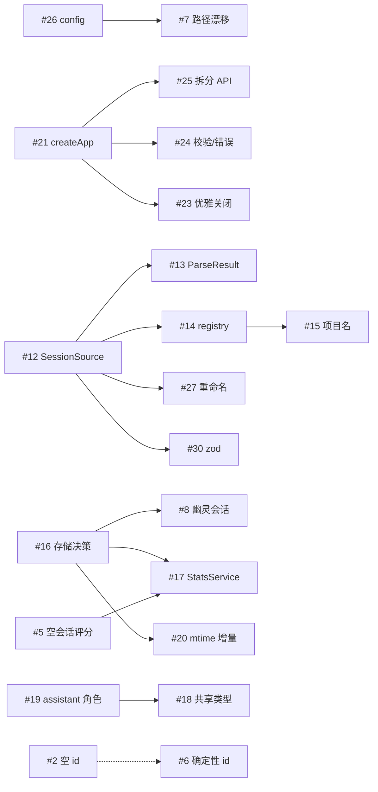

# Agent 执行综述:server 架构整改

> **本文档的读者**:接手本仓库整改工作的 AI agent 或开发者。
> **来源**:GitHub epic [#1](https://github.com/HunDun0Ben/chat-analyze/issues/1) 及其 30 个子 issue(#2–#31)。
> **基线**:commit `2574112`,`server/` 测试基线 9 个文件 / 36 个用例全绿。
> **生成时间**:2026-10-29。

---

## 0. 30 秒速读

如果你只有 1 分钟,记住这五条:

1. **不要自创顺序。** 严格执行本文第 5 节的 10 个 PR,一个 PR 只覆盖指定 issue。
2. **先读 issue 再动手。** 每个 issue 正文都有「证据(文件:行号)/影响/建议方案/验收标准」,以它为准。
3. **不要扩大范围。** 看到顺手的坏味道,记到 issue 评论里,不要顺手改。
4. **每个 PR 必须自证。** 新增测试 + `npx prettier --write .` + `npm run preflight` 全绿才算完成。
5. **遇到前置未合并就停下。** 依赖没满足时,在 issue 下留言说明阻塞,不要"先写个临时版"。

---

## 1. 背景与边界

### 1.1 项目

- Monorepo(npm workspaces):`server/`(Node + TypeScript + Express + SQLite + chokidar)、`ui/`(React + Vite + Tailwind)、`docs/`。
- `server/` 的职责:扫描 Gemini / ChatGPT 的本地会话文件 → 解析为统一的 `AnalyzedSession` → 内存索引 → REST API 供 UI 与外部 agent 使用。
- 架构原则:**Filesystem-First**,文件是唯一真相,DB 是缓存。

### 1.2 本次整改要解决的问题

对 `server/`(25 个源文件、约 3.9k 行)的评审发现 30 项缺陷,分为:

| 等级 | 数量 | 性质                                              |
| ---- | ---- | ------------------------------------------------- |
| P0   | 10   | 会造成数据丢失/污染/内容损坏,或路径漂移等运维事故 |
| P1   | 13   | 架构与契约缺陷,拖慢后续所有改动                   |
| P2   | 7    | 可读性、测试组织、文档漂移                        |

### 1.3 不在本次范围内

- 不重写 UI 视觉与交互(仅 #18/#19 需要同步类型与渲染判断)。
- 不调整教练评分公式的业务含义(#5 只处理"空会话是否计入统计",不改权重)。
- 不新增 provider(但 #14 要为将来接 Claude/OpenAI 留下扩展点)。
- 不引入新框架(不换 Express、不换 better-sqlite3、不引入 DI 容器)。

---

## 2. 不可协商的项目规则

来源:`AGENTS.md`。违反这些规则的 PR 一律不接受。

| 规则         | 具体要求                                                                                            |
| ------------ | --------------------------------------------------------------------------------------------------- |
| 语言         | 与人类交流使用**中文**;代码注释与标识符用英文                                                       |
| 格式化       | 提交前必须 `npx prettier --write .`                                                                 |
| 全量校验     | 提交 PR 前必须 `npm run preflight` 通过(格式 → lint → 类型 → 测试 → 构建)                           |
| 类型安全     | **严禁 `any`**;也不要用 `as` 断言掩盖不确定的运行时数据(用 zod,见 #30)                              |
| ESM          | `server/` 已启用 `type: module`,所有相对导入**必须带 `.js` 后缀**                                   |
| 提交信息     | Conventional Commits(`fix(server): ...`、`refactor(server): ...`、`test(server): ...`、`docs: ...`) |
| Git 操作     | 使用 `gh`(版本 2.45.0)完成 issue / PR 操作                                                          |
| 主题         | 若改动 UI,禁止硬编码颜色,必须用 `docs/THEMING.md` 中的 CSS 变量                                     |
| 测试         | 核心逻辑、Hook、服务模块必须补单测;断言要精确(`getByRole`/`getByTestId`,不要 `getByText('0')`)      |
| 环境变量测试 | 用 `vi.stubEnv` / `vi.unstubAllEnvs`,禁止直接改 `process.env`                                       |

**快速循环 vs 完整验证**:

```bash
# 快速(单测,约 1 秒)
npm test -w @chat-analyze/server

# 完整(P0-2 之前必须跑)
npx prettier --write .
npm run preflight
```

---

## 3. Issue 总览

共 30 个子 issue。`PR` 列即第 5 节中的执行批次,**不要跨批次合并**。

| #                                                           | 级别 | 标题                                 | PR    | 主要文件                                                  |
| ----------------------------------------------------------- | ---- | ------------------------------------ | ----- | --------------------------------------------------------- |
| [#2](https://github.com/HunDun0Ben/chat-analyze/issues/2)   | P0   | 空 sessionId 导致 Map 中会话互相覆盖 | PR-2  | `core/manager.ts`、`core/parsers/*`                       |
| [#3](https://github.com/HunDun0Ben/chat-analyze/issues/3)   | P0   | JSONL 用字面量 `\n` 连接多段内容     | PR-2  | `core/parsers/GeminiJsonlParser.ts`                       |
| [#4](https://github.com/HunDun0Ben/chat-analyze/issues/4)   | P0   | `turns` 在三个解析器中语义不一致     | PR-8  | 三个 parser                                               |
| [#5](https://github.com/HunDun0Ben/chat-analyze/issues/5)   | P0   | 空会话得 100 分并计入全局均分        | PR-7  | `core/services/CoachService.ts`、统计层                   |
| [#6](https://github.com/HunDun0Ben/chat-analyze/issues/6)   | P0   | Checkpoint/JSONL 非确定性时间戳与 ID | PR-5  | `core/parsers/*`                                          |
| [#7](https://github.com/HunDun0Ben/chat-analyze/issues/7)   | P0   | exports 与 DB 路径随启动方式漂移     | PR-3  | 新增 `config/`、`api/server.ts`、`db/storage.ts`          |
| [#8](https://github.com/HunDun0Ben/chat-analyze/issues/8)   | P0   | 文件删除后保留幽灵会话               | PR-7  | `core/watcher.ts`、`core/manager.ts`、`db/storage.ts`     |
| [#9](https://github.com/HunDun0Ben/chat-analyze/issues/9)   | P0   | JSONL `$set` 可覆盖任意字段          | PR-2  | `core/parsers/GeminiJsonlParser.ts`                       |
| [#10](https://github.com/HunDun0Ben/chat-analyze/issues/10) | P0   | XML Prompt 属性值未转义              | PR-1  | `api/server.ts`                                           |
| [#11](https://github.com/HunDun0Ben/chat-analyze/issues/11) | P0   | 无标题会话输出 `undefined...`        | PR-1  | `api/server.ts`                                           |
| [#12](https://github.com/HunDun0Ben/chat-analyze/issues/12) | P1   | BaseParser 契约与实现不符            | PR-5  | 新增 `core/parsing/source.ts`                             |
| [#13](https://github.com/HunDun0Ben/chat-analyze/issues/13) | P1   | `analyze()` 联合返回类型             | PR-5  | `core/parser.ts`、`core/manager.ts`                       |
| [#14](https://github.com/HunDun0Ben/chat-analyze/issues/14) | P1   | 格式探测硬编码且默认回退 Gemini      | PR-6  | 新增 `core/parsing/registry.ts`                           |
| [#15](https://github.com/HunDun0Ben/chat-analyze/issues/15) | P1   | 项目名三处来源                       | PR-6  | `core/services/DiscoveryService.ts`、`ProjectResolver.ts` |
| [#16](https://github.com/HunDun0Ben/chat-analyze/issues/16) | P1   | SQLite 只写不读                      | PR-7  | `db/storage.ts`                                           |
| [#17](https://github.com/HunDun0Ben/chat-analyze/issues/17) | P1   | 统计逻辑三份实现                     | PR-7  | 新增 `core/stats/StatsService.ts`                         |
| [#18](https://github.com/HunDun0Ben/chat-analyze/issues/18) | P1   | 前后端类型双份且漂移                 | PR-8  | 新增 `shared/`、`ui/src/types.ts`                         |
| [#19](https://github.com/HunDun0Ben/chat-analyze/issues/19) | P1   | 用 `'gemini'` 表示 assistant 角色    | PR-8  | `types/index.ts`、所有 parser、UI                         |
| [#20](https://github.com/HunDun0Ben/chat-analyze/issues/20) | P1   | 并发无上限且无 mtime 增量            | PR-7  | `core/manager.ts`                                         |
| [#21](https://github.com/HunDun0Ben/chat-analyze/issues/21) | P1   | API 层不可测                         | PR-4  | 新增 `app.ts`、`api/__tests__/`                           |
| [#22](https://github.com/HunDun0Ben/chat-analyze/issues/22) | P1   | 默认监听 `0.0.0.0` 且 CORS 全开      | PR-1  | `api/server.ts`                                           |
| [#23](https://github.com/HunDun0Ben/chat-analyze/issues/23) | P1   | 缺少优雅关闭                         | PR-9  | `index.ts`、`api/server.ts`、`db/storage.ts`              |
| [#24](https://github.com/HunDun0Ben/chat-analyze/issues/24) | P1   | 无统一错误处理与参数校验             | PR-4  | 新增 `api/middleware/`                                    |
| [#25](https://github.com/HunDun0Ben/chat-analyze/issues/25) | P2   | 拆分 `api/server.ts`                 | PR-9  | `api/routes/`、`api/prompts/`、`api/services/`            |
| [#26](https://github.com/HunDun0Ben/chat-analyze/issues/26) | P2   | 抽离手写配置解析                     | PR-3  | 新增 `config/`、`index.ts`                                |
| [#27](https://github.com/HunDun0Ben/chat-analyze/issues/27) | P2   | 重命名 `core/parser.ts`              | PR-5  | 改名 + 移动 `extractContent`                              |
| [#28](https://github.com/HunDun0Ben/chat-analyze/issues/28) | P2   | 合并重复递归                         | PR-2  | `core/services/DiscoveryService.ts`                       |
| [#29](https://github.com/HunDun0Ben/chat-analyze/issues/29) | P2   | 测试与脚本散落三处                   | PR-10 | `__tests__/`、`scripts/`、`package.json`                  |
| [#30](https://github.com/HunDun0Ben/chat-analyze/issues/30) | P2   | 用 zod 替代成片 `as` 断言            | PR-5  | 各 parser 入口                                            |
| [#31](https://github.com/HunDun0Ben/chat-analyze/issues/31) | P2   | 死代码与文档漂移                     | PR-10 | 多处 + `docs/`                                            |

---

## 4. 依赖关系与并发规则

### 4.1 硬依赖

| 必须先做 | 阻塞               | 原因                                                |
| -------- | ------------------ | --------------------------------------------------- |
| #12      | #13、#14、#27、#30 | 同一次方法签名变更                                  |
| #14      | #15                | 项目名规则必须挂在 provider 注册表上                |
| #16      | #8、#17、#20       | 存储方案 A/B 决定删除接口、SQL 统计去留、指纹表结构 |
| #5       | #17                | 先定"空会话是否计入"的规则,再实现统计               |
| #19      | #18                | 先改角色枚举,再冻结共享类型                         |
| #26      | #7                 | #7 是 #26 的子集                                    |
| #21      | #23、#24、#25      | 需要 `createApp()` 与 `http.Server` 句柄            |
| #2       | #6                 | 共用 `resolveSessionId` 稳定摘要逻辑                |
| #3       | #30                | zod schema 要覆盖 `string \| {text}` 两种形态       |

### 4.2 依赖图



图是**无环**的。第 5 节的 PR 顺序就是一个合法拓扑序,直接照做即可。

### 4.3 并发规则

**默认串行。** 只有下面这一组可以真正并行(文件集合不相交):

```
Agent-A: PR-1 (api/server.ts)
Agent-B: PR-2 (core/parsers、core/services/discovery、core/manager)
```

其余情况一律等上一个 PR 合并到 `main` 后再开工。原因见 4.4。

### 4.4 文件所有权表

| 文件/目录         | 归属 PR                   | 说明                                      |
| ----------------- | ------------------------- | ----------------------------------------- |
| `api/server.ts`   | PR-1 → PR-3 → PR-4 → PR-9 | 全场最热文件,任何时刻只允许一个 agent 改  |
| `index.ts`        | PR-3 → PR-9               | 配置抽离 + 关闭流程                       |
| `core/parsers/**` | PR-2 → PR-5 → PR-6 → PR-8 | 10 个 issue 命中同一目录,串行执行         |
| `core/manager.ts` | PR-2 → PR-5 → PR-7        | 被 id 兜底、ParseResult、增量同步三次修改 |
| `db/storage.ts`   | PR-3 → PR-7               | 路径 + 存储方案                           |
| `types/index.ts`  | PR-8                      | 角色枚举与共享类型                        |
| `ui/src/**`       | PR-8                      | 仅类型与渲染判断同步                      |

---

## 5. 执行计划:10 个 PR

> 每个 PR 都基于上一个 PR 合并后的 `main` 创建分支。
> PR 标题格式:`<type>(server): <一句话>`,正文用 `Closes #x, #y` 关联 issue。

### PR-1 `fix(server): 修正 API 层三个独立缺陷`

**覆盖**:#10 XML 转义、#11 `undefined...` 标题、#22 绑定与 CORS
**为什么最先做**:三处都是一行到十行的局部修复,不涉及架构;先清掉可以在做 API 重构前缩小噪声。

**改动**

- `server/api/server.ts`
  - 新增 `escapeXml(value)`:`&` `<` `>` `"` `'` 全部转义,文本与属性都用它
  - `:312-313` 与 `:332-333` 的标题回退改为 `s.sessionTitle ?? (s.questions[0] ? s.questions[0].slice(0, 50) + '...' : 'Untitled')`
  - `cors()` 限制为 `http://localhost:5173` / `http://127.0.0.1:5173`(允许通过 `CORS_ORIGINS` 覆盖)
  - `app.listen(port, host)`,`host = process.env.HOST ?? '127.0.0.1'`
- `server/package.json`(如需)新增 `supertest` 及类型(可选,若本 PR 就写测试)

**测试**

- `api/__tests__/prompt-format.spec.ts`:标题含 `A & B "quote"` 时,生成结果可被 XML 解析(可用 `fast-xml-parser`,或退化为断言不含裸 `&` 且标签配对)
- 标题回退三种情况:有 `sessionTitle` / 只有 `questions[0]` / 两者都无

**完成标志**

- `?format=prompt` 输出的属性值中不存在裸 `&` 或 `"`
- 默认启动后 `ss -ltnp | grep 3001` 显示绑定 `127.0.0.1`
- 从局域网另一台设备访问被拒绝

**风险**:改 CORS 可能影响 UI 开发端口。先确认 `ui/vite.config.ts` 的端口,再写白名单。

---

### PR-2 `fix(server): 修正解析与索引层的确定性缺陷`

**覆盖**:#2 空 sessionId、#3 字面量 `\n`、#9 `$set` 白名单、#28 合并重复递归
**为什么第二**:不依赖任何架构改动,且为 PR-5 的 id/内容处理打基础。

**改动**

- 新增 `core/parsing/shared/ids.ts`(目录不存在就建,PR-5 会继续用)
  - `resolveSessionId(raw, filePath, index)`:`raw.sessionId ?? raw.conversation_id ?? raw.id ?? sha256(filePath + ':' + index).slice(0, 32)`
- `core/manager.ts`:`set` 前断言 id 非空,空则 `console.warn` 并跳过
- `core/parsers/GeminiJsonlParser.ts`
  - `.join('\\n')` → `.join('\n')`
  - `$set` 只允许 `lastUpdated` / `sessionTitle` / `modelId`,其余键累加 warning 计数
  - 内容片段类型改为 `string | { text: string }`
- `core/services/DiscoveryService.ts`:合并 `collectFiles` / `collectSessions` 为单个 `walk(dir, files)`

**测试**

- 两个都没有 id 的会话同时存在时,`getAllSessions()` 返回 2 条(不能互相覆盖)
- 两个 `content` 片段解析后 `content.split('\n').length === 2`
- `{"$set":{"messages":[]}}` 不影响已收集消息
- 单个子目录不可读不影响同 watchPath 下其他目录

**禁止**:不要顺手改 `analyze()` 的返回类型(那是 PR-5)。

---

### PR-3 `refactor(server): 抽出统一配置与路径解析`

**覆盖**:#26 配置模块、#7 路径漂移

**改动**

- 新增 `server/config/index.ts`
  - `loadConfig(): ServerConfig`,字段:`watchPaths: string[]`、`port: number`、`host: string`、`dbPath: string`、`exportsDir: string`
  - 优先级:`process.env` > `config.json` > `.env` > 默认值,并在启动日志打印生效来源
  - 仓库根定位:从 `import.meta.url` 向上查找含 `workspaces` 的 `package.json`,**不要用 `process.cwd()`**
  - 用 Node 20.12+ 的 `process.loadEnvFile()` 取代手写 dotenv 解析
- `server/index.ts` 只保留 `loadConfig → bootstrap → 信号注册`,行数 < 60
- `server/db/storage.ts` 默认参数改为由 config 注入,不再用 `'./chat_analyze.db'`
- `server/api/server.ts` 的两处 `path.resolve(__dirname, '../../exports/skills')` 改为使用 `config.exportsDir`
- 启动日志使用真实的 `host:port`

**测试**

- `.env` 写 `PORT=4000` 后 `loadConfig().port === 4000`
- 四种来源的优先级各有断言
- 从仓库根与从 `server/` 启动得到相同 `dbPath` / `exportsDir`

**完成标志**

- `npm run dev` 与 `node server/dist/index.js` 的 exports 目录一致
- `index.ts` < 60 行

**风险**:`exportsDir` 可能已有历史产物。改造后保留旧路径的读取兼容(或加一个一次性迁移提示),不要静默丢弃。

---

### PR-4 `refactor(server): 让 API 层可测试`

**覆盖**:#21 createApp、#24 统一错误处理与参数校验

**改动**

- 新增 `server/app.ts`:`createApp(deps: { manager: SessionManagerLike }): Express`
- `server/api/server.ts` 改为 `startServer(deps): Promise<http.Server>`,不再内部吞掉 `listen` 返回值
- 新增 `api/middleware/errorHandler.ts` 与 `api/middleware/validateQuery.ts`
  - zod schema:`project?`、`category?`、`minScore?`(0-100)、`maxScore?`(0-100)、`limit?`(1-500,默认 50)、`offset?`(≥0)、`format?`
  - 非法值 → `400 { error, field }`
- 11 个路由删除各自的 `try/catch`,统一交给错误中间件
- `manager.getProjects(provider)` 的 `as` 强转改为显式校验

**测试**(新增 `api/__tests__/`,用 supertest + 随机端口)

至少覆盖:

- `/api/sessions/summary` 200
- `/api/sessions/:id` 404
- `/api/user-questions?minScore=abc` → 400
- `/api/user-questions?limit=0` → 400 或默认值(在 issue 里先定一种,写进测试)
- 内部抛错 → 500 且不泄漏堆栈

**禁止**:不要在本 PR 拆分路由文件(那是 PR-9),只做"可测 + 校验"。

---

### PR-5 `refactor(server): 统一解析器契约`

**覆盖**:#12 `SessionSource`、#13 `ParseResult`、#27 重命名、#30 zod、#6 确定性
**这是全项目最大的一刀,建议单独一个工作日,不要和其他 PR 并行。**

**改动**

- 新增 `core/parsing/source.ts`

  ```ts
  export interface SessionSource {
    filePath: string;
    fileName: string;
    stat: { mtimeMs: number; size: number };
    readJson(): Promise<unknown>;
    lines(): AsyncIterable<string>;
  }
  ```

- `core/parser.ts` → `core/parsing/SessionAnalyzer.ts`,类名 `SessionParser` → `SessionAnalyzer`
- `analyze(source)` 统一返回 `ParseResult { sessions: AnalyzedSession[]; warnings: ParseWarning[] }`
- `BaseParser` 抽象方法改为 `parse(source: SessionSource): Promise<AnalyzedSession[]>`,删除 `analyze(rawData, options)` 形态
- `extractContent` 移到 `core/parsing/shared/content.ts`;各 provider 提供自己的 `normalizeContent`
- 每个 provider 用 zod 定义 raw schema(`.passthrough()`),`safeParse` 失败产出 warning 而不是崩溃
- 时间戳与 id 使用 `source.stat.mtimeMs` 与行号/index 派生,删除 `new Date()` 兜底与 `crypto.randomBytes`
- `core/manager.ts` 删除全部 `Array.isArray` 分支

**测试**

- 每个 provider 一条"幂等性"测试:同一文件解析两次 `toEqual`
- 未知格式 JSON 不产出会话,`warnings` 含原因
- JSON 数组中的坏条目进 `warnings`,好条目仍解析
- 既有 36 个用例全部改为新契约后仍通过

**完成标志**

- `grep -r "as Record<string, unknown>" server/core/parsing` 为 0
- `grep -r "Array.isArray(result)" server/core` 为 0
- `grep -rn "new Date().toISOString()" server/core/parsers` 为 0(除非有显式注释说明)

**风险**:这是全仓导入路径大改。先机械改名 + 跑 `tsc --noEmit`,再逐 provider 迁移,不要一次性重写全部逻辑。

---

### PR-6 `refactor(server): provider 注册表与项目名收敛`

**覆盖**:#14 格式探测、#15 项目名三处来源

**改动**

- 新增 `core/parsing/registry.ts`:`ProviderDefinition { id, canParse(probe), placeholderProjectName, resolveProjectName(filePath, watchRoot), create() }`,按顺序尝试,全部失败返回 warning
- `DiscoveryResult` 精简为 `{ filePath, watchRoot }`
- `ProjectResolver` 改为调用注册表中的 `resolveProjectName` / `placeholderProjectName`,删除字符串白名单
- 解析器不再自填占位项目名,由分析流程统一填充

**测试**

- 各 provider 的 `canParse` 正/负例
- 项目名恰好为 `Unknown` 的会话不被覆盖
- 启动扫描与 watcher upsert 得到相同 projectName(复用既有 `manager_naming.spec.ts` 场景)

**完成标志**

- 新增 provider 只需新增一个定义文件 + 注册一行
- `grep` 不到对 `DiscoveryResult.projectName` 的读取

---

### PR-7 `refactor(server): 统一存储与统计`

**覆盖**:#16 存储方案、#8 幽灵会话、#17 StatsService、#20 并发与 mtime、#5 空会话规则
**已定案**:采用方案 C(见 6.1)——保留 SQLite 设计,默认关闭写入。

**改动**

- `core/services/CoachService.ts`:无用户消息时返回 `null` 或标记 `scoreable: false`
- 新增 `core/stats/StatsService.ts`:`summary` / `timeline` / `byModel` / `byProject` / `userQuestions`,内部统一过滤 `userTurns > 0`
- `db/`:`SessionStore` 端口 + `SessionStorage` 实现;新增 `filePath` 列与 `deleteByFilePath`,
  修复 `getStatsTimeline` 取到最旧 30 天的问题;默认不实例化(不建库、不写库)
- `core/manager.ts`:并发上限 8;进程内 `(mtimeMs,size)` 指纹跳过未变化文件;
  `removeByPath()` 同时清理内存、指纹与(启用时)数据库
- `core/watcher.ts`:新增 `unlink` → `manager.removeByPath()`
- `core/watcher.ts`:注册 `unlink` / `unlinkDir` → `manager.removeByPath`
- `manager` 维护 `filePath → sessionId[]` 反向索引
- API 路由中的聚合循环改为调用 `StatsService`

**测试**

- 删除文件后 `/api/sessions/summary` 不再包含该会话,DB 行已删除
- 混入 3 个空会话后均分不变
- 二次 `init()` 对未变化文件的解析调用次数为 0(用 mock parser 计数)
- 1000 个文件的并发读取 ≤ 8

**完成标志**

- 全仓统计实现只有一份
- `getStatsTimeline` 若保留,`LIMIT` 方向正确(取最新 30 天)

---

### PR-8 `refactor: 统一消息角色与共享类型`

**覆盖**:#19 assistant 角色 → #4 turns 口径 → #18 共享类型
**顺序不能反**:先改角色,再统一 turns,最后冻结共享类型。

**改动**

- `server/types/index.ts`:`type: 'user' | 'assistant' | 'system' | 'info'`
- 三个 parser 的映射同步;`geminiTurns` → `assistantTurns`,保留一个版本的 `@deprecated` 别名
- `turns = userTurns + assistantTurns`,三处统一调用 `shared/src/stats.ts` 的 `turnStats()`
- 新增 `shared/` workspace 包(`@chat-analyze/shared`,纯类型 + zod schema),`server` 与 `ui` 都从它导入
- 删除 `ui/src/types.ts` 中重复定义;**决策**:`/api/stats/timeline` 选择"补字段",现在返回 `sessionCount` / `totalTokens`,
  Dashboard 的总会话数与总 token 卡片因此不再恒为 0
- UI 中 `type === 'gemini'` 的判断改为 `type === 'assistant'`
- 共享包构建产物 (`shared/dist`) 不提交;`prepare` + 根脚本的 `build:shared` 保证 `npm ci` / `preflight` 顺序正确

**测试**

- 同一份对话用三种 provider 数据构造,`turns` 相同
- ChatGPT 会话消息类型为 `assistant`
- UI 渲染快照与改造前一致

**风险**:`geminiTurns` 若被 UI 直接读取,必须先加别名再删。用 `grep -rn "geminiTurns"` 确认。

---

### PR-9 `refactor(server): 拆分路由与补齐生命周期`

**覆盖**:#25 拆分 `api/server.ts`、#23 优雅关闭

**改动**

- 拆分:
  - `api/routes/{sessions,projects,stats,questions,skills}.ts`,每个 < 120 行
  - `api/prompts/{coach-audit.md,skill-extraction.md}`,用占位符注入,不再内联 230 行字符串
  - `api/services/PromptBuilder.ts`(复用 PR-1 的 `escapeXml`)
  - `api/services/SkillExport.ts`(用 `config.exportsDir` + 原子写:先写 `.tmp` 再 `rename`)
- 关闭流程:`SIGINT` + `SIGTERM` → `watcher.stop()` → `server.close()` → `storage.close()`,10 秒超时兜底

**测试**

- 提示词 golden test:变量替换正确、XML 合法
- 关闭顺序:用一个假的 `http.Server` 断言 `close` 被调用
- 路由拆分后 PR-4 的 API 用例全部仍通过

**完成标志**

- `api/` 下单文件 ≤ 120 行
- 源码中无超过 20 行的内联字符串

---

### PR-10 `chore(server): 清理死代码与同步文档`

**覆盖**:#29 测试脚本整理、#31 死代码与文档

**改动**

- 删除 `manager.refresh()`、`parser.getCoachService()` 等无调用导出(`ts-prune` / `knip` 辅助)
- `__tests__/parser.spec.ts` 与 `parser.test.ts` 合并;测试与源码共置(`core/parsers/__tests__/...`)
- `scripts/verify-*.ts` 中有价值的转成 vitest 用例,其余删除
- 删除 `package.json` 的 `test:parser`(第二套 runner)
- 更新 `docs/SYNC_STRATEGY.md`(删除"启动时删除脏 DB"等未实现描述)、`docs/PARSER_ARCHITECTURE.zh-CN.md`、`docs/DATA_STRUCTURE.md`

**完成标志**

- `npm test -w @chat-analyze/server` 一条命令覆盖全部单测
- 文档描述与代码一致
- `npx knip`(或 `ts-prune`)无重大未使用导出

---

## 6. 待决策事项(ADR)

开工前必须有人拍板;没有结论时按"推荐默认"执行,并在 PR 描述里注明。

### 6.1 #16 存储方案:已定案 C(保留设计,默认停写)

| 选项  | 内容                                      | 状态            |
| ----- | ----------------------------------------- | --------------- |
| A     | 真做缓存:指纹表 + 启动先读 DB + 增量校验  | 暂缓            |
| B     | 删除持久层,只保留内存                     | 不采用          |
| **C** | **保留 SQLite 与会话表设计,默认关闭写入** | ✅ **当前方案** |

**决策(2026-10-30)**:先保留数据库设计与 `SessionStorage` 实现,但默认 `PERSISTENCE=off`,
进程不打开数据库文件,也不产生任何写入;需要时用 `PERSISTENCE=sqlite` 打开。
跨重启的增量缓存(方案 A)留待以后重新评估,当前只做进程内指纹跳过与并发上限。

理由:避免继续写入 63MB/802 行的陈旧数据与幽灵行,同时不放弃将来做启动缓存的可能。

### 6.2 #24 `limit=0` 的语义

- 推荐:**返回 400**。`limit=0` 在语义上无意义,且当前实现会退化为"返回全部",是最坏的行为。

### 6.3 #13 `ParseResult` 是否带 warnings 计数上限

- 推荐:warnings 只保留前 100 条 + 一个 `truncated: boolean`,避免大目录内存膨胀。

### 6.4 #18 共享包形态

- 推荐:新增 `shared/` 作为第三个 npm workspace(`@chat-analyze/shared`),只放类型与 zod schema,不放运行时代码。
- 备选:用 `ui/tsconfig` 的 path alias 直接引用 `server/types`(更快但耦合方向错误,不推荐)。

### 6.5 #19 `geminiTurns` 弃用窗口

- 推荐:保留一个 minor 版本的只读别名,PR 描述里标注移除计划。

---

## 7. Agent 操作规程

### 7.1 认领与确认

```bash
# 1. 读 issue 全文(含证据与验收标准)
gh issue view 2

# 2. 确认依赖已合并(对照第 4 节)
gh issue view <前置编号> --json state -q .state   # 期望 CLOSED

# 3. 确认没有别人正在做
gh issue view 2 --json assignees,comments
```

**如果前置未合并或 issue 描述与代码不符:停止编码**,在 issue 下评论说明,然后切换到其他可开工的 PR。

### 7.2 分支与提交

```bash
git switch -c fix/2-session-id-collision
# 小步提交,每个提交可独立说明
git commit -m "fix(server): 为缺失 sessionId 的会话生成稳定兜底 id"
```

约定:

- 分支名:`fix/<issue>-<slug>`、`refactor/<issue>-<slug>`、`test/<issue>-<slug>`
- 一个 PR 只对应本文指定的 issue 集合,不夹带无关改动
- 不修改与 issue 无关的文件;发现新问题 → 新建 issue 并在 PR 里引用

### 7.3 提交前自检

```bash
npx prettier --write .
npm test -w @chat-analyze/server   # 快速循环
npm run preflight                            # 必须全绿
```

### 7.4 创建 PR

```bash
gh pr create \
  --title "fix(server): 为缺失 sessionId 的会话生成稳定兜底 id" \
  --body "Closes #2

## 改动
- ...

## 验证
- [x] npm run preflight
- [x] 新增测试 xxx

## 风险
- ..."
```

PR 正文必须包含:**关联 issue(`Closes #`) / 改动清单 / 验证方式 / 风险与回滚**。

### 7.5 收尾

- PR 合并后,issue 会被 `Closes #` 自动关闭
- 手动到 epic [#1](https://github.com/HunDun0Ben/chat-analyze/issues/1) 勾选对应条目(issue 引用不会自动打勾)
- 若本次改动让某份 `docs/` 失效,同一 PR 内更新

---

## 8. 验证命令速查

| 目的         | 命令                                                  |
| ------------ | ----------------------------------------------------- |
| 单测(server) | `npm test -w @chat-analyze/server`                    |
| 单测(watch)  | `npx vitest -w @chat-analyze/server`                  |
| 类型检查     | `npm run typecheck:server`                            |
| Lint         | `npm run lint -w @chat-analyze/server`                |
| 构建         | `npm run build -w @chat-analyze/server`               |
| 全量门禁     | `npm run preflight`                                   |
| 启动服务     | `npm run dev:server`                                  |
| 手动验证 API | `curl -s localhost:3001/api/sessions/summary \| head` |

---

## 9. 反模式禁入清单

以下写法是本轮整改要消除的对象,**不要在新代码中重新引入**:

| 禁止                                                     | 因为               | 对应 issue |
| -------------------------------------------------------- | ------------------ | ---------- |
| 在调用方写 `Array.isArray(result)`                       | 统一返回数组       | #13        |
| 在 parser 里 `new Date()` 兜底时间戳                     | 破坏幂等与排序     | #6         |
| `crypto.randomBytes()` 生成消息 id                       | 每次解析结果不同   | #6         |
| `path`/`db` 使用 `process.cwd()` 或 `__dirname` 相对路径 | dev/build 漂移     | #7         |
| `Object.assign(session, record.$set)`                    | 可覆盖任意字段     | #9         |
| `parseInt(req.query.x as string)`                        | NaN 静默失效       | #24        |
| 路由内联 `try/catch`                                     | 需要统一错误中间件 | #24        |
| 在 `createApp` 里 `listen`                               | 无法测试与优雅关闭 | #21        |
| 新增第二份前端类型定义                                   | 契约漂移           | #18        |
| 用 `'gemini'` 表示 assistant                             | provider/role 混淆 | #19        |
| `as Record<string, unknown>` 链式取值                    | 掩盖数据形态       | #30        |
| 内联超过 20 行的提示词字符串                             | 不可读不可测       | #25        |
| 在 handler 里 `fs.writeFileSync`                         | 阻塞 + 路径耦合    | #25        |
| 硬编码 `http://localhost:3001` 日志                      | 与真实配置不符     | #26        |

---

## 10. 关键文件地图(当前基线)

```
server/
├── index.ts                     # 入口 + 手写配置解析(210 行)
├── api/server.ts                # 11 个路由 + 230 行提示词(558 行)
├── app.ts                       # ← PR-4 新增
├── config/                      # ← PR-3 新增
├── core/
│   ├── manager.ts               # 内存索引 + 全量同步
│   ├── parser.ts                # 分发器(联合返回类型)
│   ├── parsers/
│   │   ├── BaseParser.ts        # extractContent 在此
│   │   ├── GeminiParser.ts      # 静态 JSON
│   │   ├── GeminiJsonlParser.ts # 流式事件
│   │   ├── GeminiCheckpointParser.ts
│   │   └── ChatGPTParser.ts
│   ├── watcher.ts               # chokidar add/change(缺 unlink)
│   └── services/
│       ├── CoachService.ts      # 评分/分类/纠错
│       ├── DiscoveryService.ts  # 文件发现
│       ├── ProjectResolver.ts   # 项目名
│       └── discovery/{ignored,projectNaming}.ts
├── db/storage.ts                # SQLite(只写)
├── types/index.ts               # 领域模型
└── __tests__/                   # 9 文件 / 36 用例
```

**测试基线(不要减少)**:`chatgpt_parser`、`checkpoint_parser`、`coach_service`、`discovery_service`、`gemini_jsonl_parser`、`manager_naming`、`parser`(spec/test 各一份,PR-10 合并)、`project_resolver`。

---

## 11. 完成定义(DoD)

一个 PR 只有在以下全部满足时才算完成:

- [ ] 覆盖了 issue 中「验收标准」的全部条目
- [ ] 新增/更新了对应测试,且测试断言具体(不是 `toBeTruthy`)
- [ ] `npx prettier --write .` 已执行
- [ ] `npm run preflight` 全绿
- [ ] 没有引入第 9 节的任何反模式
- [ ] 没有 `any`、没有新增无解释的 `as`
- [ ] PR 正文含 `Closes #x`、改动清单、验证方式、风险
- [ ] 行为变化已同步到相关 `docs/`

全部 30 个 issue 关闭 + epic #1 勾选完毕 = 整改完成。

---

## 12. 遇到分歧时

1. **以 issue 正文为准**,其次以本文件的顺序为准,再次以 `docs/` 为准。
2. 三者冲突时:先提 issue 评论说明冲突,再在 PR 描述里记录取舍,不要静默选一个。
3. 不确定的实现细节(命名、文件位置、函数签名)优先服从本文第 5 节的目录结构;本文未规定时,服从周边代码的既有风格。
4. 任何"顺手优化"的想法 → 记成新 issue,不在当前 PR 实施。
